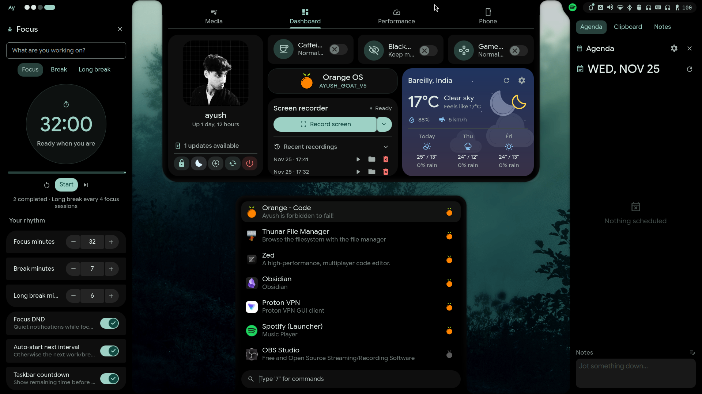

<div align="center">

# 🟠 OrangeDots · Orange OS

**A polished Arch Linux + Hyprland desktop, powered by a custom Quickshell shell.**

<sub>Orange OS is based on <a href="https://github.com/caelestia-dots/shell">Caelestia</a>.</sub>




</div>

> [!NOTE]
> This is a **desktop shell + dotfiles repo**, not an OS installer or an Arch ISO. You install the system dependencies yourself, then add Orange OS on top of your existing Hyprland session.

---

## 📑 Contents

[Quick start](#-quick-start) · [Features](#-features) · [Requirements](#-requirements) · [Installation](#-installation) · [Full dotfiles (optional)](#-optional-full-hyprland-dotfiles) · [Customize](#-first-run-customization) · [Commands](#-commands-and-shortcuts) · [Config & backups](#-configuration-backups-and-migration) · [Updating](#-updating) · [Troubleshooting](#-troubleshooting) · [Uninstall](#-uninstall) · [Development](#-development) · [License](#-license)

---

## ⚡ Quick start

Already running **Hyprland** with the [dependencies](#step-1--install-arch-packages) installed? Three steps:

```bash
# 1. Get the code and link the shell
git clone https://github.com/srivastava-ayush/OrangeDots.git ~/OrangeDots
cd ~/OrangeDots
bash install.sh --dry-run     # preview first
bash install.sh               # link shell + seed missing presets

# 2. Build the native modules
cmake -S quickshell/caelestia -B quickshell/caelestia/build -G Ninja \
  -DCMAKE_BUILD_TYPE=Release -DCMAKE_INSTALL_PREFIX=/usr \
  '-DENABLE_MODULES=extras;plugin;m3shapes' -DVERSION=1.0.0
cmake --build quickshell/caelestia/build --parallel 2
sudo cmake --install quickshell/caelestia/build

# 3. Try it
qs -c caelestia -n            # test run (Ctrl+C to stop)
orangeos shell -d             # start for real
```

> [!IMPORTANT]
> Keep a working terminal and a way back to a TTY. Back up your existing config before replacing it. Test password unlock before relying on the lock screen. **Never run Quickshell as root.**

---

## ✨ Features

| Area | What you get |
|---|---|
| 🧱 **Taskbar** | Left or top orientation. Three styles: **Unified** (default), **Three notches**, **Center notch**. |
| 🔔 **Notifications** | Bell in the status group with a hover popout. Banners are kept separate from history. |
| 🎨 **Theming** | Material 3 colours from your wallpaper, adjustable transparency and tint. **VOID** preset = pure black. |
| 📊 **Dashboard** | Weather, recording controls, utility cards, performance info, phone integration, Calendar tab with notes and optional Google Calendar (iCal). |
| 🎥 **Screen recording** | Native resolution, `ultra` preset, no downscaling. Quality, codec, fps and cursor are configurable. |
| ⚙️ **Nexus** | One in-shell settings overlay for everything above. |
| 🪟 **Hyprland dotfiles** | Optional Lua config with scratchpads, gestures and overview-plugin integration. |

Also included: launcher, lock screen, media controls and system tray.

📖 Full inventory: [docs/FEATURES.md](docs/FEATURES.md)

---

## 📋 Requirements

- **Arch Linux** with a working **Hyprland (Wayland)** session and a normal user with `sudo`
- **`quickshell-git`** (not an older tagged release)
- **Qt 6.9+**, with Quickshell and the native modules built against compatible Qt versions
- Internet access (packages, CLI, and CMake's pinned M3Shapes download)

Other distributions aren't covered. The bundled Hyprland config uses the **Lua API**; don't paste it into a classic `hyprland.conf` setup.

### Pick your scope

| | Shell only *(recommended first)* | Full dotfiles |
|---|---|---|
| Installs Orange OS | ✅ | ✅ |
| Keeps your Hyprland config | ✅ | ❌ replaced |
| Keybinds & autostart | You add them | Included |
| Best for | Trying it out safely | Fresh setups / matching my machine |

> [!TIP]
> All command blocks use **Bash**. If your interactive shell is Fish, run `bash` first. Examples assume the clone lives at `~/OrangeDots`.

---

## 🛠 Installation

### Step 1 · Install Arch packages

Update first, and avoid partial upgrades:

```bash
sudo pacman -Syu
```

```bash
sudo pacman -S --needed \
  git base-devel cmake ninja pkgconf python \
  qt6-base qt6-declarative qt6-shadertools qt6-svg qt6-wayland \
  libqalculate libpipewire aubio cava lm_sensors \
  networkmanager bluez bluez-utils upower \
  brightnessctl ddcutil fish curl jq libnotify \
  wl-clipboard cliphist playerctl grim slurp swappy matugen \
  ttf-cascadia-code-nerd ttf-jetbrains-mono-nerd noto-fonts-emoji
```

<details>
<summary><b>Hyprland or PipeWire not installed yet?</b></summary>

Get a working Hyprland session **before** installing the shell:

```bash
sudo pacman -S --needed hyprland xdg-desktop-portal-hyprland
```

Typical audio stack for a new install (review conflicts rather than replacing an existing setup):

```bash
sudo pacman -S --needed pipewire pipewire-pulse wireplumber
systemctl --user enable --now pipewire.socket pipewire-pulse.socket wireplumber.service
```

Or log out and back in after installing.
</details>

### Step 2 · Install AUR dependencies

With an AUR helper such as `yay`:

```bash
yay -S --needed quickshell-git libcava ttf-material-symbols-variable-git
```

Review the build files and prompts. `libcava` is required by the native audio visualizer; the `cava` executable alone doesn't guarantee its development library.

**You don't need a separate CLI package.** The command-line companion ships in this repo as `orangeos-cli`. Install it after cloning (Step 3):

```bash
python3 -m pip install --user ./orangeos-cli
# or, without installing: symlink bin/orangeos into ~/.local/bin
```

It provides the `orangeos` command for wallpaper, schemes, recording, emoji, clipboard and shell control.

### Step 3 · Clone, back up and link the shell

**Recommended: use the installer script.**

```bash
git clone https://github.com/srivastava-ayush/OrangeDots.git "$HOME/OrangeDots"
cd "$HOME/OrangeDots"

bash install.sh --dry-run   # preview
bash install.sh             # apply
```

The installer:

- ✅ preserves your existing preferences and private files
- ✅ backs up conflicting shell entries to `${XDG_STATE_HOME:-$HOME/.local/state}/orangedots/backups/`
- ✅ seeds only **missing** JSON presets
- ❌ does **not** install packages, build native modules, or restart your session

For the full dotfiles, use `bash install.sh --full` (preview with `--full --dry-run`).

<details>
<summary><b>Manual installation (equivalent)</b></summary>

```bash
git clone https://github.com/srivastava-ayush/OrangeDots.git "$HOME/OrangeDots"

repo="$HOME/OrangeDots"
config_home="${XDG_CONFIG_HOME:-$HOME/.config}"
backup="$HOME/.local/share/orangedots-backups/$(date +%Y%m%d-%H%M%S)"

mkdir -p "$backup" "$config_home/quickshell" "$config_home/caelestia"

# Preserve existing CLI/shell preferences, including private local settings.
cp -a "$config_home/caelestia" "$backup/caelestia"

# Move only an existing caelestia shell entry, not your other Quickshell configs.
if [[ -e "$config_home/quickshell/caelestia" || -L "$config_home/quickshell/caelestia" ]]; then
  mv "$config_home/quickshell/caelestia" "$backup/quickshell-caelestia"
fi

ln -s "$repo/quickshell/caelestia" "$config_home/quickshell/caelestia"

# Seed presets only when the destination does not already exist.
for file in shell.json shell-tokens.json cli.json; do
  if [[ ! -e "$config_home/caelestia/$file" && ! -L "$config_home/caelestia/$file" ]]; then
    cp "$repo/caelestia/$file" "$config_home/caelestia/$file"
  fi
done
```

The symlink reads QML directly from the clone, so **keep the repository in place**.
</details>

> [!NOTE]
> The display name is **Orange OS** and the command is **`orangeos`**, but the runtime config name (`qs -c caelestia`), native QML imports, layer namespaces and data directories keep the **`caelestia`** name for compatibility. Don't rename them.

> [!WARNING]
> Don't install the upstream `caelestia-shell` / `caelestia-shell-git` packages as a substitute for building this repo. They can supply incompatible native modules or a different shell config. Review any already-installed package and the files it owns before replacing it.

### Step 4 · Build and install the native modules

QML is interpreted by Quickshell; this step compiles only the **native dependencies**.

Check that the dev libraries are discoverable:

```bash
pkg-config --modversion Qt6Core Qt6WaylandClient wayland-client libqalculate libpipewire-0.3 aubio
pkg-config --exists libcava || pkg-config --exists cava
```

Build from the bundled source:

```bash
repo="$HOME/OrangeDots"

cmake -S "$repo/quickshell/caelestia" \
  -B "$repo/quickshell/caelestia/build" -G Ninja \
  -DCMAKE_BUILD_TYPE=Release \
  -DCMAKE_INSTALL_PREFIX=/usr \
  '-DENABLE_MODULES=extras;plugin;m3shapes' \
  -DVERSION=1.0.0

cmake --build "$repo/quickshell/caelestia/build" --parallel 2   # drop --parallel if unsupported
sudo cmake --install "$repo/quickshell/caelestia/build"
```

<details>
<summary><b>What do these flags mean?</b></summary>

- `--parallel 2` limits memory use; raise it if you have the RAM.
- `VERSION=1.0.0` is a **numeric CMake build version** (your clone may lack a usable Git tag). It's separate from the version shown on the About page.
- `extras;plugin;m3shapes` installs native helpers and QML modules without installing a second QML shell over the symlinked source.
- M3Shapes is fetched from a pinned Git revision during configuration, so network access is required.
- With this prefix, files go to `/usr/lib/caelestia` and `/usr/lib/qt6/qml`. A different library location needs a matching `CAELESTIA_LIB_DIR` at launch, and custom QML import paths must be discoverable by Qt.
- **Rebuild after every Qt upgrade**, since the core module links against Qt private APIs.
- When updating, stop the shell **while unlocked** before replacing native libraries.
</details>

### Step 5 · Fonts

| Font | Purpose / source |
|---|---|
| Material Symbols Rounded | Shell icons. Installed by the AUR font package above. |
| GoogleSansFlex | Bundled in `quickshell/caelestia/assets/google-sans-flex/`; loaded automatically. |
| CaskaydiaCove NF | Monospace text. From the Cascadia Code Nerd Font package. |
| JetBrainsMono Nerd Font | Taskbar logo and other Nerd Font glyphs. |
| Rubik | Clock/workspace font. Get it from [Google Fonts](https://fonts.google.com/specimen/Rubik) or a font package. |

For manually downloaded fonts, put the `.ttf`/`.otf` files in `~/.local/share/fonts/`, then verify:

```bash
mkdir -p "$HOME/.local/share/fonts"
fc-cache -f
fc-match 'Material Symbols Rounded'
fc-match 'CaskaydiaCove NF'
fc-match 'JetBrainsMono Nerd Font'
fc-match 'Rubik'
```

> [!TIP]
> Check the **returned family name**, not the exit status. `fc-match` can silently pick a fallback.

### Step 6 · Enable services and optional features

```bash
sudo systemctl enable --now NetworkManager.service   # only if it's your network manager
sudo systemctl enable --now bluetooth.service
```

Don't enable NetworkManager alongside another service managing the same interfaces without planning the migration.

Optional features (a missing tool only disables that one feature):

| Feature | Requirements |
|---|---|
| **Screen recording** | `gpu-screen-recorder`, a supported GPU/driver, recording permissions |
| **Power profiles** | `power-profiles-daemon` + its system service (avoid TLP/tuned conflicts) |
| **Phone integration** | `kdeconnect`, a running `kdeconnectd`, a paired phone |
| **External-display brightness** | Monitor DDC/CI support and `ddcutil` / I²C permissions |
| **Network/auth prompts** | A polkit authentication agent in your session |
| **GPU statistics** | Working GPU driver tools; pick the matching GPU config in Nexus |

### Step 7 · Start the shell and verify

Run these **inside your Hyprland session** as your normal user (not root, SSH or another TTY):

```bash
quickshell --version
hyprctl monitors
qs -c caelestia -n          # foreground; shows loading errors
```

If an instance is already running, read its log instead of launching another:

```bash
orangeos shell -l
```

When the foreground launch works, stop it with `Ctrl+C` **while unlocked**, then launch normally:

```bash
orangeos shell -d
orangeos shell nexus open
```

> [!TIP]
> The preset hides the taskbar until hover. Move your pointer to the **left edge**, or enable **Persistent** in Nexus.

**Sanity checklist before daily use:**

- [ ] Launcher opens
- [ ] Audio and network icons respond
- [ ] Notification bell works
- [ ] Dashboard and Nexus open
- [ ] Password unlock works (test this before relying on the lock screen)

Disable any conflicting notification daemon or bar autostart, and don't indiscriminately kill unrelated Quickshell instances.

### Step 8 · Wallpaper and colour scheme

A fallback wallpaper is included; your own collection is not.

```bash
mkdir -p "$HOME/Pictures/Wallpapers"
# add your images, then point at a real file:
orangeos wallpaper -f "$HOME/Pictures/Wallpapers/your-wallpaper.jpg"
```

Or pick one in Nexus, or:

```bash
orangeos shell wallpapers pick
orangeos shell wallpaperswitcher toggle
orangeos scheme set -n dynamic -m dark
```

The generated scheme lives at `${XDG_STATE_HOME:-$HOME/.local/state}/caelestia/scheme.json`. If you use the bundled Hyprland palette too, keep `hypr/scheme/current.lua` consistent with it. Shell tint is only an overlay and doesn't rewrite that Lua palette.

### Step 9 · Autostart and shortcuts (your own Hyprland config)

If you're keeping your existing **Lua-based** Hyprland config, merge this into your startup handler and binds. Avoid duplicate shell autostarts:

```lua
hl.on("hyprland.start", function()
    hl.exec_cmd("orangeos shell -d")
end)

hl.bind("SUPER + X", hl.dsp.exec_cmd("orangeos shell nexus open"))
hl.bind("SUPER + D", hl.dsp.exec_cmd("orangeos shell drawers toggle dashboard"))
hl.bind("SUPER + L", hl.dsp.exec_cmd("orangeos shell lock lock"))
hl.bind("SUPER + SUPER_L", hl.dsp.exec_cmd("orangeos shell drawers toggle launcher"), { release = true })
```

For other Hyprland config formats, use your version's own startup/bind mechanism to run the same commands; don't mix syntaxes.

```bash
hyprctl reload
```

A startup handler only runs on the **next session start**; use `orangeos shell -d` to start now. The shell-only steps install **no** keybinds automatically.

---

## 🧩 Optional: full Hyprland dotfiles

> [!NOTE]
> **Skip this if you want to keep your current window-manager setup.** Shell-only is enough for Orange OS.

### 1 · Adapt the config first

Review `hypr/hyprland.lua` and the refresh-rate script before linking:

| Setting | Current assumption | Change to |
|---|---|---|
| Monitor | `1920x1080@144` | A mode/scale your display supports (`hyprctl monitors`) |
| Refresh-rate script | `eDP-1`, 60/144 Hz, origin `0x0` | Your output name, rates and position |
| `SUPER+SHIFT+R` | `hypr/scripts/toggle-refresh-rate.sh` | Adapt hardware-specific modes in the helper |
| IDE command | `zed` on `PATH` | Your editor (`zed`, `code`, …) |
| App commands | `kitty`, `yazi`, `helium-browser`, Spotify, Obsidian, Blueman, Pavucontrol | Install them, or replace the binds |
| Startup apps | `kdeconnectd`, clipboard watchers, `hyprpm reload -n` | Keep only integrations you installed |
| Plugins | ScrollOverview; guarded Hypr3D / HyprGlass | Install compatible plugins or remove the references |

The terminal wrapper lives at `quickshell/caelestia/assets/wrap_term_launch.sh`; `SUPER+Q` / `SUPER+A` use it for the terminal and Yazi.

### 2 · Set up the overview plugin (if using its binds)

The config references [ScrollOverview](https://github.com/yayuuu/hyprland-scroll-overview) (`SUPER+Escape`, gestures, overview hot corner):

```bash
hyprpm add https://github.com/yayuuu/hyprland-scroll-overview.git
hyprpm update
hyprpm enable scrolloverview
hyprpm reload
```

Plugins must match your installed Hyprland version, so update them after each Hyprland upgrade. Not using ScrollOverview? Remove its Lua references and disable the overview hot corner in Nexus.

### 3 · Back up and link

```bash
repo="$HOME/OrangeDots"
config_home="${XDG_CONFIG_HOME:-$HOME/.config}"
backup="$HOME/.local/share/orangedots-backups/$(date +%Y%m%d-%H%M%S)"
mkdir -p "$backup" "$config_home"

if [[ -e "$config_home/hypr" || -L "$config_home/hypr" ]]; then
  mv "$config_home/hypr" "$backup/hypr"
fi

ln -s "$repo/hypr" "$config_home/hypr"
```

Or use `bash install.sh --full`. Activate in a controlled session. The config **already autostarts** `orangeos shell -d`, so don't add a second autostart from the shell-only steps. The main file is **`hyprland.lua`**, not classic `.conf` syntax.

> [!WARNING]
> `~/bin/power-watcher.sh`, `~/bin/refresh-rate.sh` and `power-watcher.service` from the original machine are **not included**. Automatic AC/battery refresh-rate switching must be recreated separately.

---

## 🎛 First-run customization

Open **Nexus** with `orangeos shell nexus open` (or `SUPER+X` with the bundled binds). It's an animated **in-shell overlay**; dismiss it with `Esc` or the close button. Most settings apply live.

| I want to change… | Go to |
|---|---|
| Orientation, style, persistence | **Panels → Taskbar** |
| Notification bell/shade and hover behavior | **Panels → Taskbar → Notification shade** |
| Status icons and order | **Panels → Taskbar → Status icons** |
| Center notch size | **Panels → Taskbar → Center notch size** |
| Tint, VOID, presets, strength, reset | **Wallpaper & style → Shell tint** |
| Wallpaper, transparency, dark/light | **Wallpaper & style** |
| Weather visibility, location, units | **Panels → Dashboard** |
| Utility cards, overview hot corner | **Panels → Dashboard → Utilities** |
| Calendar tab and notes | **Panels → Dashboard → Calendar & notes** |
| Recorder quality, codec, fps, cursor | **Services → Screen recorder** |
| Release label, system details | **About** |

Tint doesn't replace the Material accent scheme. For a fully opaque VOID, turn off **Transparency** separately.

### Taskbar styles

| Style | Behavior |
|---|---|
| **Unified** *(default)* | One taskbar with your configured entry order and active-window settings. |
| **Three notches** | Logo/workspaces at the start, date/time centered, tray/status at the end. Notches merge into the shell border. Switching back to Unified restores your order and settings. |
| **Center notch** | Only the date/time notch is drawn. Everything else sits directly on the wallpaper as white silhouettes with a dark shadow for contrast. |

**Center notch size:** minimum width (Top) or height (Left) in logical pixels. `0` = Auto (fits the clock). It can't shrink below its contents or overlap neighboring notches. Auto-hide and hover popouts work in every style.

### Optional personal touches

| Item | How |
|---|---|
| **Profile photo** | Copy an image to `~/.face`, or use the dashboard's photo control. |
| **Weather** | Enter a city or `latitude, longitude` in Nexus. Uses Open-Meteo; no API key needed. |
| **Google Calendar** | Paste your **Secret address in iCal format** (Calendar → *Integrate calendar*) into **Nexus → Panels → Dashboard → Calendar & notes**. It's stored privately at `${XDG_CONFIG_HOME:-$HOME/.config}/caelestia/calendar-url`. **Treat it like a password:** never commit it or paste it into issues. |
| **Screen locking** | Password PAM config lives in `assets/pam.d/`. Fingerprint/face need their own system setup. Keep a recovery session while testing, and never copy arbitrary PAM files into `/etc/pam.d`. |

---

## ⌨️ Commands and shortcuts

### CLI (works with or without the bundled keybinds)

```bash
orangeos shell -d                       # start detached
orangeos shell -r                       # restart
orangeos shell -k                       # stop
orangeos shell -l                       # show logs
orangeos shell -s                       # list IPC commands
orangeos shell nexus open               # open Nexus
orangeos shell drawers toggle dashboard
orangeos shell drawers toggle launcher
orangeos shell drawers toggle notifShade
```

### Bundled `hyprland.lua` shortcuts

| Shortcut | Action |
|---|---|
| `SUPER+X` | Nexus |
| `SUPER+D` | Dashboard |
| `SUPER+SUPER_L` (on release) | Launcher |
| `SUPER+L` | Lock |
| Tap `SUPER+SHIFT` | Toggle taskbar persistence |
| `SUPER+SHIFT+T` | Cycle taskbar style: Unified → Three notches → Center notch |
| `SUPER+SHIFT+T+O` | Toggle orientation Left ↔ Top (hold `T`, then press `O`) |
| `SUPER+ALT+1..4` | Media / Dashboard / Performance / Phone (subject to enabled tabs) |
| `SUPER+Q` / `SUPER+A` | Terminal / Yazi via the bundled wrapper |
| `SUPER+S` | Spotify scratchpad |
| `SUPER+SHIFT+R` | Toggle refresh rate |
| `SUPER+Escape` | ScrollOverview (when installed) |

See `hypr/hyprland.lua` for the complete, current list.

---

## 💾 Configuration, backups and migration

The committed JSON files are **first-install presets**, not a synced copy of your Nexus changes. Seeding never overwrites your live preferences. Paths honor `XDG_CONFIG_HOME` / `XDG_STATE_HOME`.

| Location | Contains |
|---|---|
| `~/.config/caelestia/shell.json` | Main Nexus preferences |
| `~/.config/caelestia/shell-tokens.json` | Font/size/style token overrides |
| `~/.config/caelestia/cli.json` | CLI options (incl. native-resolution recording) |
| `~/.config/caelestia/monitors/<output>/` | Per-monitor overrides (output names must match the new machine) |
| `~/.config/caelestia/weather.json` | Weather refresh interval |
| `~/.config/caelestia/calendar-url` | 🔒 Private calendar URL |
| `~/.local/state/caelestia/taskbar.json` | Orientation, style, center notch size |
| `~/.local/state/caelestia/shell-tint.json` | Custom tint, strength, enabled state |
| `~/.local/state/caelestia/hot-corner.json` | Overview hot-corner settings |
| `~/.local/state/caelestia/scheme.json` | Generated Material palette |
| `~/.local/state/caelestia/wallpaper/path.txt` | Current wallpaper's absolute path (not the image) |
| `~/.local/state/caelestia/notifs.json` | 🔒 Notification history (may contain private text) |
| `~/Pictures/Wallpapers`, `~/.face`, recordings | Your personal media |

**Migrating to a new machine:** back up the live `caelestia` config/state directories privately and copy your media separately. Reselect the wallpaper on the new machine instead of relying on an old absolute path.

> [!CAUTION]
> Never commit calendar secrets, notification history or other private runtime data. To deliberately update this repo's presets, copy your live JSON into `caelestia/` and review the diff first.

---

## 🔄 Updating

```bash
repo="$HOME/OrangeDots"
git -C "$repo" status --short
git -C "$repo" pull --ff-only
```

- Back up live settings and inspect local edits first.
- With conflicting local edits, commit or back them up and resolve them. **Don't hard-reset.**
- Don't reseed live JSON over your preferences on every update.
- QML-only changes usually hot-reload. For a clean restart: `orangeos shell -r`
- After native-source, Qt or Quickshell ABI changes, repeat [Step 4](#step-4--build-and-install-the-native-modules), then restart. A Qt upgrade may also require rebuilding `quickshell-git`.
- Update Hyprland plugins separately when Hyprland changes.

---

## 🩺 Troubleshooting

### Start here

```bash
orangeos shell -l          # shell logs
qs list --all              # running instances
hyprctl monitors
hyprctl configerrors
```

Before sharing logs, strip credentials, private calendar URLs, notification text and machine-specific info.

### Symptom guide

| Symptom | What to check |
|---|---|
| `module "Caelestia..." is not installed` / `M3Shapes` missing | Build and install this repo's native modules, not just the QML. Check the install prefix and Qt import path. |
| CMake can't infer `VERSION` | Pass `-DVERSION=1.0.0`. |
| `libcava`, `cava`, Qalculate, PipeWire, Aubio or sensors missing | Install the dev libraries, check pkg-config and `lm_sensors`, re-run CMake configure. |
| Qt symbol/ABI errors after an upgrade | Rebuild Quickshell and the native modules against the same Qt. Don't mix old packaged modules with this repo. |
| Config `caelestia` not found | Run `readlink -f ~/.config/quickshell/caelestia`. A top-level `quickshell/shell.qml` can interfere with discovery; back it up and reconcile rather than deleting. Diagnose with `qs -p "$HOME/OrangeDots/quickshell/caelestia" -n`. |
| No taskbar | The preset is hover-to-reveal on the left. Check the left edge, monitor overrides, and **Persistent** in Nexus. |
| Two bars / notification-server registration errors | Remove duplicate autostarts, disable the competing notification daemon, restart only the relevant shell. |
| Wi-Fi / Bluetooth / audio controls missing | Check NetworkManager, `bluetooth.service`, PipeWire/WirePlumber and your auth agent. |
| Icons are squares or literal names | Check Material Symbols Rounded and Nerd Font resolution, refresh the font cache, restart. |
| Wallpaper/scheme errors | Choose an existing wallpaper via the CLI and regenerate state. Don't copy another user's absolute path. |
| Login/config parse errors with full dotfiles | Confirm a Lua-compatible Hyprland, adapt monitor/app paths, check ScrollOverview references. Return to your backup if needed. |
| Recording doesn't start | Check `gpu-screen-recorder`, GPU support, audio devices and the CLI recording command. |
| Recording is downscaled / low quality | **Services → Screen recorder → Reset to highest quality**, or make sure `~/.config/caelestia/cli.json` has `"record": {"extraArgs": ["-s", "0x0", "-q", "ultra", "-tune", "quality"]}`, then restart recording. |
| Calendar is empty | Check the private iCal URL file and your network. The parser doesn't expand every recurring-event rule. |
| Pure-black preset still looks translucent | VOID sets tint strength, not opacity. Turn off **Transparency**. |

---

## 🧹 Uninstall

1. Stop the shell: `orangeos shell -k`
2. Remove its autostart and binds.
3. Restore saved config entries from `~/.local/share/orangedots-backups/` (manual install) or `${XDG_STATE_HOME:-$HOME/.local/state}/orangedots/backups/` (installer).
4. Remove **only the symlinks you created**, not a whole config directory or the clone they point to.
5. Keep your live state if you want your preferences later.

The native-module install is separate from the symlinks. Review `quickshell/caelestia/build/install_manifest.txt` and package ownership before removing system files. Don't recursively delete Qt's QML directory, and don't assume CMake provides an uninstall target.

---

## 🧪 Development

### Layout and install checks

Safe to run: they never touch your real config.

```bash
python3 scripts/check-layout.py
python3 -m unittest discover -s tests -v
```

These validate an exported checkout at another path (including paths with spaces), fresh/full installs, backups, existing preferences, legacy symlinks and the CMake staged shell install. See [docs/STRUCTURE.md](docs/STRUCTURE.md) for the module map and compatibility rules.

### Integration tests

Run from the repo root, inside a Wayland session with the native modules installed. They use isolated config/state and a transparent, input-free test surface.

```bash
python3 quickshell/caelestia/tests/integration.py                 # everything
python3 quickshell/caelestia/tests/integration.py --mode tint     # focused run
```

Coverage: taskbar orientation/styles, notch geometry, popout sizing/hover, notification shade, Nexus navigation, recorder settings, tint/VOID, persistence and invalid settings.

### Weather helper tests (require Node.js)

```bash
node --test quickshell/caelestia/tests/weather.test.cjs
```

> [!NOTE]
> These checks don't replace testing your real GPU, audio devices, network permissions, recording and lock/PAM behavior.

### Repository layout

| Path | Purpose |
|---|---|
| `install.sh`, `scripts/install.py` | Safe shell/full-dotfiles linking and preset seeding |
| `caelestia/*.json` | First-install shell, token and CLI presets |
| `hypr/hyprland.lua` | Personal Hyprland config (Lua) |
| `hypr/scheme/current.lua` | Hyprland-side colour palette |
| `hypr/scripts/` | Shell toggle, Spotify scratchpad, hardware-specific refresh modes |
| `quickshell/caelestia/shell.qml` | Orange OS shell entry point |
| `quickshell/caelestia/modules/` | UI modules: taskbar, dashboard, settings, launcher, lock screen, notifications |
| `quickshell/caelestia/services/` | Runtime services: tint, taskbar state, weather, notifications |
| `quickshell/caelestia/plugin/` | Native QML modules (rebuild when native code changes) |
| `quickshell/caelestia/assets/` | Fallback wallpaper, Google Sans Flex, PAM files, helper assets |
| `quickshell/caelestia/tests/` | Integration and weather tests |
| `docs/FEATURES.md`, `docs/STRUCTURE.md` | Feature inventory, module map, compatibility rules |

---

## 📄 License

Orange OS is based on [Caelestia](https://github.com/caelestia-dots/shell). The shell under `quickshell/caelestia/` keeps its **GPL-3.0** license and upstream notices. Top-level personal dotfiles are unrestricted: use and adapt them as you like.